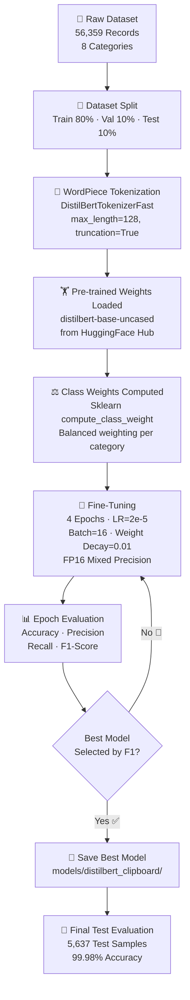
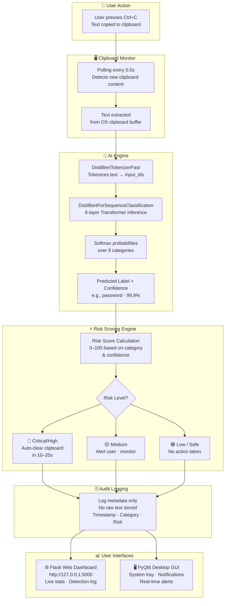
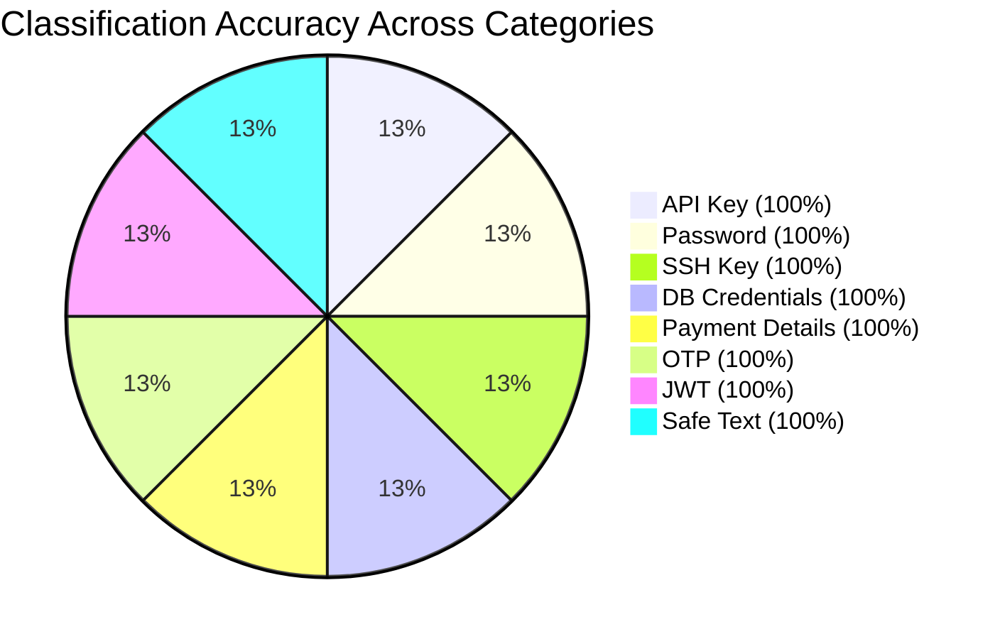

# AI-Powered Clipboard Security Guardian
## Presentation Slides (`ppt.md`)

---

## Slide 1: Title Slide

### AI-Powered Clipboard Security Guardian
**Real-Time Sensitive Data Protection using DistilBERT & Flask**

- **Project:** AI-Powered Clipboard Security Guardian
- **Student Name:** Nivin Padaveettil
- **Register No.:** JCE24CC044
- **Department:** CSE(CYBER SECURITY) S5
- **Institution:** Jawaharlal College of Engineering and Technology

---

## Slide 2: Problem Statement

### The Danger of Clipboard Exposure

- **Unprotected Buffer:** System clipboard stores copied text in plain text.
- **Accidental Leakage:** Users copy passwords, API keys, and OTPs, accidentally pasting them into public chats or AI tools.
- **Malware Risk:** Clipboard-sniffing software can steal credentials silently.
- **Lack of Auto-Clear:** Standard OS does not clear sensitive clipboard content automatically.

---

## Slide 3: Objectives

### Project Goals

1. **Real-Time Monitoring:** Detect copied clipboard text instantly.
2. **AI Classification:** Use a fine-tuned **DistilBERT** model to classify text into 8 categories.
3. **Risk Scoring Engine:** Calculate risk level (Low, Medium, High, Critical).
4. **Auto-Clear Sanitization:** Automatically purge sensitive text after a timeout (10s – 30s).
5. **Web & GUI Dashboards:** Provide a Flask Web Interface and PyQt6 Desktop GUI for monitoring.

---

## Slide 4: Dataset & Security Categories

### Dataset Overview

- **Total Samples:** 56,359 records
- **8 Sensitivity Categories:**
  1. `api_key` (API Tokens)
  2. `password` (Passwords & Secrets)
  3. `ssh_key` (Private SSH Keys)
  4. `db_credentials` (Database URLs)
  5. `payment` (Credit Card / CVV)
  6. `otp` (One-Time Passwords)
  7. `jwt` (JSON Web Tokens)
  8. `safe` (Normal Plain Text)

---

## Slide 5: Machine Learning Model

### Why DistilBERT?

- **Backbone:** `distilbert-base-uncased` (Lightweight Transformer)
- **Fast & Efficient:** 40% smaller and 60% faster than standard BERT.
- **Low Latency:** Runs predictions in `<10ms` on CPU/GPU.
- **Deep Understanding:** Detects secret keys, tokens, and complex text structures beyond simple regex.

---

## Slide 6: About DistilBERT — Architecture Deep Dive

### What is DistilBERT?

**DistilBERT** (Distilled BERT) is a compressed version of BERT developed by Hugging Face using **knowledge distillation**, where a smaller "student" model is trained to replicate the behavior of a larger "teacher" model (BERT).

### Architecture Specifications

| Property | BERT-base | DistilBERT |
| :--- | :---: | :---: |
| **Transformer Layers** | 12 | **6** |
| **Attention Heads** | 12 | 12 |
| **Hidden Dimensions** | 768 | 768 |
| **Parameters** | 110M | **66M** |
| **Speed vs BERT** | 1× | **1.6× faster** |
| **Size vs BERT** | 100% | **40% smaller** |
| **Performance vs BERT** | 100% | **97%** retained |

### Core Architecture Components

1. **WordPiece Tokenizer** — Breaks text into sub-word tokens (max 128 tokens for this project).
2. **Embedding Layer** — Converts tokens to 768-dimensional dense vectors.
3. **6× Transformer Encoder Blocks** — Each block contains:
   - Multi-Head Self-Attention (12 heads)
   - Feed-Forward Network (FFN) with GELU activation
   - Layer Normalization & Residual Connections
4. **Classification Head** — A fully connected dense layer mapping hidden states → 8 category logits.
5. **Softmax Output** — Converts logits to probability scores per category.

### Knowledge Distillation (How DistilBERT Was Created)

```
Teacher Model (BERT-base, 110M params)
        ↓  Soft Labels + Hidden State Matching
Student Model (DistilBERT, 66M params)
        ↓  Fine-tuned on our dataset
Clipboard Security Classifier (8 classes)
```

---

## Slide 7: DistilBERT Model Training Workflow

### Training Pipeline



### Training Hyperparameters

| Parameter | Value |
| :--- | :---: |
| **Pre-trained Model** | `distilbert-base-uncased` |
| **Epochs** | 4 |
| **Learning Rate** | `2e-5` |
| **Batch Size** | 16 (train & eval) |
| **Max Token Length** | 128 |
| **Weight Decay** | 0.01 |
| **Best Model Metric** | F1-Score |
| **Mixed Precision (FP16)** | GPU auto-enabled |
| **Class Balancing** | `compute_class_weight="balanced"` |

### Inference Pipeline (Real-Time, `predict.py`)

```python
# 1. Tokenize clipboard text
inputs = tokenizer(text, truncation=True, max_length=128)

# 2. Model forward pass (no gradient needed)
with torch.no_grad():
    outputs = model(**inputs)

# 3. Softmax → probabilities
probabilities = torch.softmax(outputs.logits, dim=1)

# 4. Argmax → predicted label + confidence
label, confidence = torch.max(probabilities, dim=1)
```

---

## Slide 8: Project End-to-End Workflow

### Full System Architecture & Data Flow



### Risk Level → Auto-Clear Timeout Mapping

| Category | Risk Level | Risk Score | Auto-Clear |
| :--- | :---: | :---: | :---: |
| `password`, `ssh_key` | 🔴 Critical | 100 | **10 – 15 seconds** |
| `api_key`, `jwt` | 🔴 Critical | 90 – 95 | **15 – 20 seconds** |
| `db_credentials`, `payment` | 🔴 High | 80 – 90 | **20 – 25 seconds** |
| `otp` | 🟡 Medium | 60 – 70 | **25 – 30 seconds** |
| `safe` | 🟢 Low | 0 | **No action** |

---

## Slide 9: Model Performance & Accuracy Graphs

### Evaluation Metrics (5,637 Test Samples)

| Metric | Score | Performance Graph |
| :--- | :---: | :--- |
| **Accuracy** | **99.98%** | `[████████████████████]` 99.98% |
| **Precision** | **99.98%** | `[████████████████████]` 99.98% |
| **Recall** | **99.98%** | `[████████████████████]` 99.98% |
| **F1-Score** | **99.98%** | `[████████████████████]` 99.98% |

### Category Accuracy Distribution Graph



---

## Slide 10: Key Features & Workflows

### How It Works

1. **Copy Action:** User copies text (`Ctrl+C`).
2. **AI Analysis:** DistilBERT analyzes text instantly.
3. **Risk Action:**
   - **Password / SSH Key:** Critical Risk (Score 100) -> Auto-clears in 10–15s.
   - **API Key / DB Connection:** Critical/High Risk (Score 90–95) -> Auto-clears in 15–20s.
   - **Safe Text:** Low Risk (Score 0) -> No action taken.
4. **Audit Logging:** Saves metadata in SQLite database (zero raw text stored for privacy).

---

## Slide 11: Web Application Implementation (`web_app.py`)

### Core Flask API Code Snippet

```python
from flask import Flask, render_template, jsonify, request
from src.predict import predict
from src.core.risk_scoring import calculate_risk

app = Flask(__name__)

@app.route("/api/predict", methods=["POST"])
def live_predict():
    data = request.json or {}
    text = data.get("text", "")
    
    # 1. Run DistilBERT Model Inference
    label, confidence = predict(text)
    
    # 2. Calculate Risk Level & Auto-Clear Action
    risk = calculate_risk(label, confidence)
    
    return jsonify({
        "success": True,
        "category": risk.category,
        "confidence": round(risk.confidence * 100, 2),
        "risk_score": risk.risk_score,
        "risk_level": risk.risk_level,
        "action": risk.action
    })

if __name__ == "__main__":
    app.run(host="127.0.0.1", port=5000)
```

---

## Slide 12: User Interfaces

### Desktop & Web Dashboards

- **PyQt6 Desktop GUI:** Runs in system tray, pops up notifications on threat detection.
- **Flask Web Interface:** Browser dashboard at `http://127.0.0.1:5000` with live statistics and detection logs.

---

## Slide 13: Conclusion & Future Scope

### Summary & Next Steps

- **Summary:** Built an AI guardian that prevents clipboard data leaks in real time with 99.98% accuracy.
- **Future Enhancements:**
  - **OCR Scanning:** Detect credentials in screenshots/images.
  - **App Whitelisting:** Allow copying passwords only to password managers.
  - **Enterprise SIEM Integration:** Send threat logs to central security tools.
